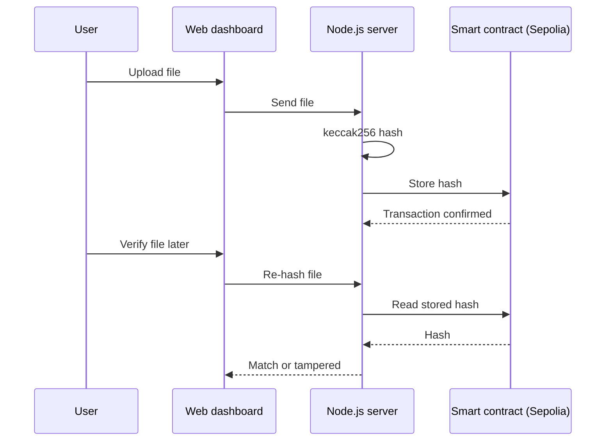

<h1 align="center">🔗 BlockProof</h1>

<p align="center">
  <b>Tamper-proof file integrity on the Ethereum blockchain</b><br/>
  Hash a file, anchor the hash on-chain, and verify it later. Any change to the file is detected.
</p>

<p align="center">
  
  
  
  
  
</p>

---

## 🎯 How It Works

1. **Upload** a file in the web dashboard.
2. The file is hashed with **keccak256** (`hashFile.js`).
3. The hash is stored through a **smart contract on the Sepolia testnet** (`networkintegrity.sol`).
4. To **verify**, upload the file again. If the new hash matches the on-chain record, the file is intact. If not, it has been tampered with.
5. The dashboard shows an **immutable history** of recorded files.



## ✨ Features

- 🔐 keccak256 file hashing
- 📜 Solidity smart contract for hash storage
- 🌐 Deployed to the **Sepolia testnet**
- 🖥️ Web dashboard for upload, validation and history
- ⛓️ Immutable, publicly auditable record

## 📁 Project Structure

```
BlockProof/
├── networkintegrity.sol        # Smart contract
├── networkintegrity_abi.json   # Contract ABI
├── connectsepolia.js           # Sepolia connection
├── hashFile.js                 # keccak256 hashing
├── server.js / app.js          # Node.js backend
├── client.js                   # Client-side logic
├── index.html / style.css      # Web dashboard
└── package.json
```

## ⚙️ Run Locally

```bash
git clone https://github.com/karthikesh15/BlockProof.git
cd BlockProof
npm install
```

Create a `.env` file with your own values (never commit it):

```env
SEPOLIA_RPC_URL=your_rpc_url
PRIVATE_KEY=your_test_wallet_private_key
CONTRACT_ADDRESS=your_deployed_contract_address
```

```bash
node server.js
```

Use a **test wallet only**, funded with Sepolia test ETH.

## 🔒 Security Note

Never commit `.env`, private keys or `node_modules`. Add them to `.gitignore`. See the checklist below if keys were ever committed.

## 👤 Author

**S D Karthikesh** | [LinkedIn](https://linkedin.com/in/karthikesh-sd) | [GitHub](https://github.com/karthikesh15) | sdkarthikesh2005@gmail.com
